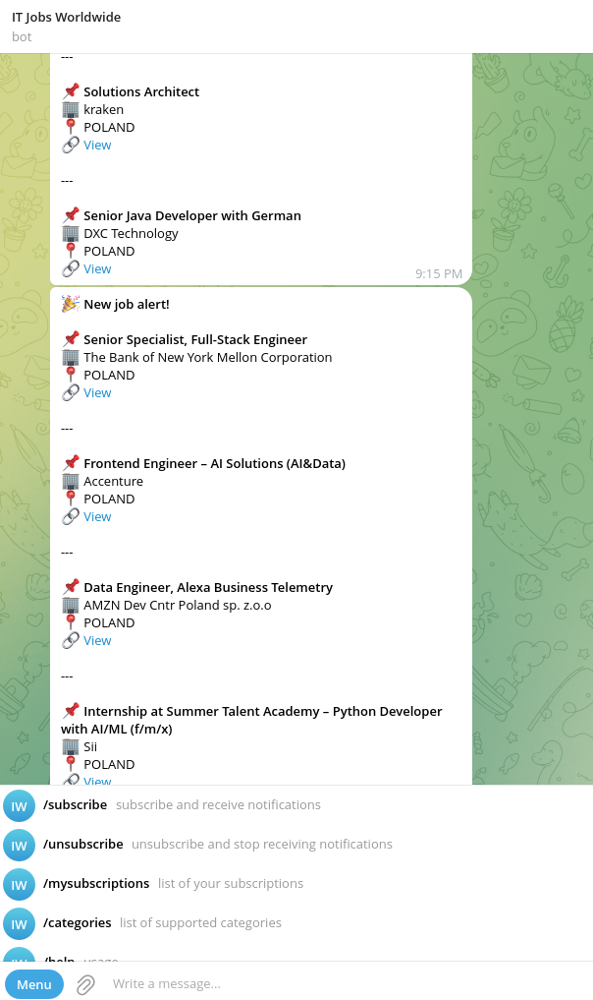
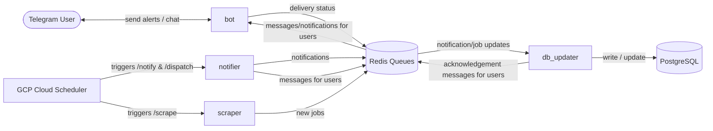

# Distributed Job Notification Pipeline (Telegram)

A distributed job notification system that scrapes job boards and delivers personalized alerts via Telegram.
The system is designed to handle asynchronous scraping, fair notification distribution across users, and external API rate limits in a serverless environment.

## Structure

### Key Design Decisions

- **Async architecture**
  Built using asyncio and async DB sessions to efficiently handle concurrent scraping and notification dispatch.

- **Fair notification dispatching**
  SQL queries make sure each user receives notifications, even if some users may be overrepresented in notifications table (e.g. users with many subscriptions)

- **Rate limiting**
  Applied both global and per-user rate limits to comply with Telegram API constraints. Scrapping domains is also rate limited to not get blocked.

- **Serverless deployment**
  Deployed on GCP Cloud Run for automatic scaling and cost efficiency.

- **Connection handling**
  Configured SQLAlchemy pooling (`pool_pre_ping`, `pool_recycle`) to handle stale connections in serverless environments.

### bot

Commands:
- /start - just a greeting message
- /subscribe <category> <location> - register for receiving job alerts
- /unsubscribe <category> <location> - cancel subscription
- /mysubscriptions - list active subscriptions
- /categories - list supported categories
- /help - usage guide

Endpoints:
- /webhook - processing messages pushed by Telegram

Main responsibility for this service is communicating with users.
For active subscriptions the bot delivers updates about new jobs found.
The bot enqueues subscribe/unsubscribe requests in a Redis queue, consumes a queue dedicated for user messages (most importantly new notifications for users).
It also registers user activity.

### scraper

Endpoints:
- /scrape - finds new jobs

This service is triggered by GCP Scheduler. It searches for new jobs for active subscriptions. Every job is then sent to a Redis queue.

### notifier

Endpoints:
- /notify - matches users with jobs and creates notifications, then sends them to a Redis queue.
- /dispatch - chooses notifications to send, then prepares Telegram messages with those notifications. Complete messages are then sent to a Redis queue.

### db_updater

Consists of background workers consuming Redis queue messages about notification, job, and user updates. Then updating the database accordingly.
Because of uniqueness constraints no job or notification is duplicated.

### Postgres

Tables:
- users
- jobs
- user_subscriptions
- notifications

### Redis

Queues:
- jobs
- notifications
- user messages

## Deployment

Bot, db_upater, and Redis are hosted on my Raspberry Pi. Postgres database is managed by neon.tech. Notifier and schedulers are on GCP.
